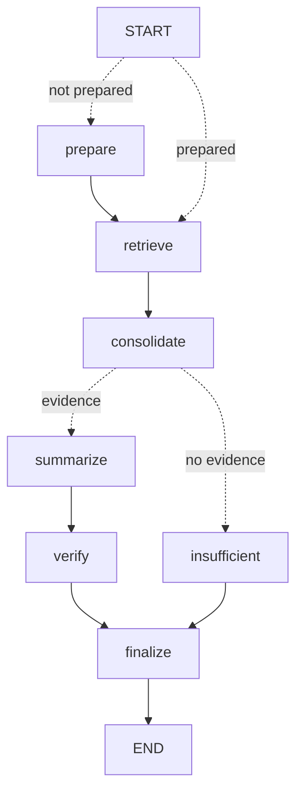

# CLAUDE.md

This file provides guidance to Claude Code (claude.ai/code) when working with code in this repository.

## Rules

1. When responding, use the `/i-have-adhd:i-have-adhd` skill.
2. When coding, use the `/andrej-karpathy-skills:karpathy-guidelines` skill.

## Project

LexisAI Architect — a single-user, local-first web app that ingests a document (PDF/DOCX/PPTX/HTML/images via Docling), runs hierarchical parent–child RAG over it, and streams an LLM summary back with clickable source snippets. The full design is in `spec.md`; user-facing setup is in `how_to_run.md`.

The repo is split into two independently managed apps that talk over HTTP:

- `backend/` — Python 3.11 + FastAPI, dependencies via `uv` in `backend/.venv`
- `frontend/` — Next.js 14 (App Router) + TypeScript + Tailwind, dependencies via `pnpm`

There is no monorepo tooling. Each side is built, run, and tested on its own.

## Commands

Backend (run from `backend/`, with `.venv` activated):

```bash
uv venv --python 3.11 && source .venv/bin/activate    # one-time
uv sync --extra dev                                   # install the exact versions in uv.lock
uv lock                                               # after editing pyproject.toml deps (commit uv.lock too)
uvicorn app.main:app --reload --port 8000             # dev server (http://localhost:8000, /docs for Swagger)
pytest                                                # tests (the tests/ dir is currently empty)
pytest tests/path/to/test_file.py::test_name          # single test
ruff check app                                        # lint
```

Frontend (run from `frontend/`):

```bash
pnpm install
pnpm dev              # http://localhost:3000
pnpm build && pnpm start   # prod build
pnpm lint             # next lint / eslint
```

Docker: `docker compose up --build` from the repo root (backend `.env` injected at runtime, `./data` bind-mounted to `/app/data`, CPU-only torch). CI (`.github/workflows/ci.yml`, every push): `ruff check app scripts tests` (ruff is pinned — newer releases enable more default rules), `pytest`, the offline retrieval gate `python scripts/eval_smoke.py`, then a build-only of both images. The gate replays `hybrid_search` + `consolidate` on `tests/fixtures/retrieval_amd.npz` (frozen AMD 10-K chunks + float16 vectors, no API calls) and exits 1 below the `GATES` floors (frozen values minus one query). Re-freeze with `scripts/freeze_retrieval_fixture.py` and re-set `GATES` when chunking, the embedding model or the labels change; raise `GATES` after a real improvement.

Wipe local state: `bash backend/scripts/wipe_data.sh` from the repo root. The script first writes a timestamped backup at `data.bak.<ts>` (embeddings cost real OpenAI dollars to regenerate) and then removes `app.db`, `uploads/`, `cache/`. Restore with `mv data.bak.<ts> data` after `rm -rf data`.

## Architecture

### Storage layout — everything under `data/` at the repo root

The backend resolves paths relative to its CWD (`backend/`) using `../data/...`. All three stores live there and must stay in sync; deleting one without the others leaves the app in a broken state. Use `DELETE /documents/{id}` (SQLAlchemy cascade — which removes the child rows and therefore the embeddings — plus filesystem unlink) rather than removing files by hand.

Embeddings used to live in a per-doc Chroma collection; they now live as float32 BLOBs on `child_chunks.embedding`, so there is no separate vector store to keep in sync. Retrieval is per-document, so a brute-force numpy cosine over those BLOBs (`services/vectorstore.py`) beats an ANN index on both latency and operational weight.

| Store      | Path                         | Holds                                                                                                                                                                                                                                    |
| ---------- | ---------------------------- | ---------------------------------------------------------------------------------------------------------------------------------------------------------------------------------------------------------------------------------------- |
| SQLite     | `data/app.db`                | `users`, `email_codes` (auth); `documents`, `parent_chunks`, `child_chunks` (metadata + full text + bbox JSON + situating `context_text` + float32 `embedding` BLOB); `queries` (cached past-query results for the drawer's Queries tab, with the verify result in `verification_json`) |
| Uploads    | `data/uploads/<doc_id><ext>` | Original files                                                                                                                                                                                                                           |
| HTML cache | `data/cache/<doc_id>.html`   | Docling's HTML render with `<span data-chunk-id=...>` anchors injected by `prepare._inject_chunk_anchors`                                                                                                                                |

### Lazy ingestion (important)

`POST /documents` only stores the file and a row with `status="ready"`. **It does not chunk or embed.** The expensive pipeline (Docling extract → clean → parent chunks → child chunks → per-parent context → embed) runs the first time `POST /query` is called, gated by `prepare.has_chunks(doc_id)` (the query graph's START edge). The same SSE stream then carries those preparation stages followed by the retrieval/summary stages, so the frontend's `PipelineVisualizer` works off real backend events, not animations.

Implication: changing chunking or extraction logic does not invalidate already-prepared documents — the gate is "any child chunk has an embedding for this doc?". `prepare_document_stream` is idempotent: it deletes the doc's existing parent/child rows up front, so to force a re-prepare you can delete the doc and re-upload, or just null out its `child_chunks.embedding` values. (That null-gate is also what migrates docs left over from the old Chroma store — their child rows exist but carry no SQLite embedding, so they re-prepare on next query.)

### Authentication

Real email-based auth with two sign-in methods: password and email code (6-digit OTP). Signup requires email + username + password, then **email verification** before the account is usable.

- All auth surface lives in `backend/app/services/auth.py` (bcrypt for passwords/OTPs, SHA-256 for high-entropy link tokens, JWT issue/decode, FastAPI deps `get_current_user_optional` / `get_current_user`, plus `resolve_user_from_token` for the `?token=` query-param path) — single swap point for production hardening. Document/query routes consume the dep and never inspect tokens themselves.
- Outbound email goes through `backend/app/services/email.py::send_email` (with `send_verification_link` / `send_reset_link` / `send_code` helpers). Backends: `console` (dev default — logs subject + body/link via INFO, nothing leaves the box) and `resend` (POSTs the Resend HTTPS API; needs `RESEND_API_KEY` + `EMAIL_FROM`). `email.last_sent()` is a test seam, not used in prod paths.
- **Signup is verification-gated**: `POST /auth/signup` creates the user `email_verified=False` and returns **no JWT** — it emails a one-time link (`{FRONTEND_URL}/verify?token=…`, 24h TTL). `POST /auth/verify` activates and signs in. Re-signing up an unverified email updates username/password and resends (idempotent). `login` and `email-code/*` return `403 email_unverified` for unverified accounts; the modal offers a "Resend link" action (`POST /auth/verify/resend`, generic 202).
- **Password reset is email-link based**: `POST /auth/password/forgot` is anti-enumeration (always 202; sends `{FRONTEND_URL}/reset?token=…`, 30-min TTL, only for a real verified account, 60s throttle). `POST /auth/password/reset` validates the token, applies the signup password policy, sets the hash, and bumps `users.password_changed_at`.
- JWT lifetime 30 days, token in `localStorage.lexisai_token`, `jti` claim present. **Session revocation on reset**: `get_current_user_optional` rejects any token whose `iat` predates `password_changed_at` (whole-second granularity), so a reset kills all outstanding sessions.
- Link tokens (verify/reset) reuse the `email_codes` table — token's SHA-256 hash in `code_hash`, `purpose` in `{"login","verify","reset"}`. Login OTP queries are scoped to `purpose=="login"` so they don't clobber verify/reset rows.
- Email codes: 6 digits, 10-min TTL, 3 attempts max, 60s resend throttle. Codes are bcrypt-hashed at rest, marked `consumed_at` on success / 3rd failure / TTL expiry — strict one-time-use.
- Login by email-code requires an existing **verified** user (honest 404 `no_account` → frontend offers "Create one"; `403 email_unverified` if pending). Codes never auto-create accounts.
- Signup password policy is enforced server-side in `routes/auth.py::_validate_signup_password`: 8+ chars (Pydantic `min_length`) + one uppercase + one symbol from `string.punctuation`. Existing users are grandfathered — `LoginRequest` and `CodeVerifyRequest` deliberately do **not** call the policy, so legacy hashes keep working. Don't add policy checks to the login paths.
- Login responses are intentionally generic 401 `invalid_credentials` for both unknown-email and bad-password; `verify_password` runs a dummy bcrypt compare on missing users to flatten timing. Don't add early returns that shortcut this.
- Anon-doc claim: anon uploads have `documents.user_id IS NULL`; on sign-in, `sessionStorage.lexisai_anon_doc` is sent to `POST /auth/claim`, which flips ownership for any null-owned matching id. uuid4 hex doc ids make squatting impractical; signed claim tokens are a deferred hardening (TODO in `routes/auth.py::claim`).
- **Per-user document access control**: `GET /documents/{id}`, `/{id}/file`, `/{id}/html`, `DELETE /documents/{id}`, and `POST /query` all run `_authorize_doc` (in `routes/documents.py`) — owned docs require the matching signed-in user; anon (`user_id IS NULL`) docs stay readable by whoever holds the id until claimed. The PDF `<iframe>` and HTML fetch can't send an Authorization header for owned docs, so `/file` and `/html` also accept the JWT as `?token=` (`PdfViewer` appends it; `HtmlViewer` sends `authHeaders()`).
- Frontend: `AuthContext` exposes `signup` (no longer auto-logs-in — returns the "verification sent" state) / `loginWithPassword` / `loginWithCode` / `requestCode` / `resendVerification` / `verifyEmail` / `requestPasswordReset` / `resetPassword` / `logout`; the login paths plus `verifyEmail` / `resetPassword` run claim-on-login internally. `LoginModal` has Sign in / Create account / Forgot-password modes (Password / Email-code sub-tabs, a post-signup "check your email" notice, and an `email_unverified` resend action). The link landing pages are `app/verify/page.tsx` and `app/reset/page.tsx`.

### Query graph (`backend/app/services/query_graph.py`)

`POST /query` checks access in the route, then relays `graph.astream(state, stream_mode="custom")`: a LangGraph `StateGraph` over a typed `QueryState` (TypedDict; inputs `doc_id`/`query`/`top_k`/`user_id`, then hits, excerpts, snippets, answer, verification). Nodes call the services below and write every SSE event themselves through the injected `writer` (a parameter, not `get_stream_writer()`, which async nodes can't reach on Python < 3.11). Sync nodes run in LangGraph's thread pool, so the blocking OpenAI calls don't stall the event loop and tokens still stream; that replaced the old hand-written thread bridge. Keep DB sessions inside nodes (open `SessionLocal` per node), never in state.



- **Evidence gate** (`_route_evidence`): no excerpts, or best child cosine over the whole doc below `EVIDENCE_MIN_COSINE` (0.12), goes to `insufficient` (fixed "not in the document" answer, no LLM call). Kept low on purpose: vague questions ("Give me an overview" 0.157) score like off-topic ones (0.07–0.36 cross-document), so a higher bar refuses valid questions; 0.12 refused none of 73 valid ones and catches only clearly unrelated queries. Re-derive it if the embedding model changes.
- **`verify`** runs after the answer has streamed, so it annotates rather than blocks it (no buffering). `services/verify.py::check` → `{status: ok | warning | insufficient_evidence, issues, needs_review}`: a refusal in the answer's first sentence → `insufficient_evidence` (matched all 212 judge-flagged abstentions in 788 past AMD answers, 3 false hits); pages cited outside every excerpt's span or numbers no excerpt states → `warning`. Regex + Decimal only, no LLM: it can't catch a wrong-but-in-range page or an unsupported claim (those need the eval's judge). The same functions back `eval_grounding.py`.
- **`finalize`** caches the result (incl. `verification_json`) for signed-in users.

### Retrieval pipeline (`backend/app/services/`)

1. **`ingest.extract`** — runs Docling, walks `doc.iterate_items()`, captures per-item page + bbox provenance (PDFs only), and also stashes `doc.export_to_html()`. Bboxes are normalized to `{x0, y0, x1, y1}` from Docling's `{l, t, r, b}` PDF-points convention.
2. **`chunker.chunk_document`** — token-based (tiktoken `cl100k_base`):
   - Parents: greedy pack of extracted items up to `PARENT_TOKENS` (default 1000). Parent text is `"\n\n".join(items)`; page span = min/max of item pages.
   - Children: sentence-split each parent on `[.!?]\s+[A-Z"'(\[]` then greedy-pack to `CHILD_TOKENS` (default 120). Oversized single sentences are emitted as their own child. IDs are deterministic: `<doc_prefix>_Parent_NNNNN` / `<...>_Child_NNNNN_KKK`.
   - Children inherit the parent's `bboxes` and page span — they do **not** track their own sub-bboxes.
   - Parents also get `marked_text`: the same text with `[page N]` inserted at each page break (NULL for non-PDFs). It is only sent to the summarizer, so the LLM cites the page a fact is actually on instead of the parent's first page; stored/shown/embedded text stays clean. Docs prepared before this column existed fall back to plain text until re-prepared.
3. **`context.generate_parent_contexts`** — Contextual Retrieval (Anthropic cookbook), adapted to this app: an LLM (`CONTEXT_MODEL`, default `gpt-4.1-mini`) writes a 1–2 sentence blurb situating each **parent** in the whole document; children inherit their parent's blurb. The blurb is prepended to the chunk (`"{context}\n\n{text}"`) before embedding **and** BM25 — so retrieval keys on document-aware text while the user still sees the bare snippet. Context is generated per-parent (not per-child) to keep first-query latency/cost bounded, runs concurrently (3 threads, with SDK 429 backoff — each call ships the whole doc, so high concurrency trips OpenAI's TPM limit on large docs), and degrades to empty context on error. The whole-document prefix is identical across a doc's calls, so OpenAI auto-caches it. **Default off** (`CONTEXTUAL_EMBEDDINGS=False`): a 16-query eval on a single-topic lease showed no recall gain and slight mid-k regression, while a 37-query eval on a 121-page 10-K showed +8.1% / +5.4% Pass@20 across two runs (mostly paraphrased queries; contextual varies run to run because the blurbs are LLM-written) — directional only (`RAG_IMPROVEMENT_REPORT.md` §6). Eval harness: `backend/scripts/eval_retrieval.py` (labels in `scripts/eval_labels/`; it fails the run if any chunk got empty context, e.g. from a 429). `--rerank MODEL` compares hybrid vs hybrid + that cross-encoder on one prepare (adds `latency_rerank_*`). It reports Pass@k, Recall@k, MRR, p50/p95 query latency and prepare time per mode, and logs every run to MLflow (`data/mlflow/`, with a baseline-vs-contextual `comparison_report.md` on each run). View it from `backend/` with `mlflow ui --backend-store-uri sqlite:///../data/mlflow/mlflow.db --port 5055` (not 5000, which macOS AirPlay owns), then switch the UI to Model training mode. Answer-side eval: `backend/scripts/eval_grounding.py` runs the real answer path (top-k 5 → consolidate → summarize) and has a `gpt-4.1` judge score groundedness, citation precision/coverage, fake pages, abstention and false refusals (experiment `grounding-<labels>`, `grounding_report.md` lists every failure). The judge tags claims `fact`/`meta` (only facts are scored) and locates each claim's `support_pages`; code compares them with the cited pages, because the judge rubber-stamps citations if asked to verify them. `--rejudge RUN_ID` re-scores a past run's answers with the current judge. Numbers are checked in code, not by the judge (the page/number checks live in `services/verify.py`, shared with the query graph's verify node): `number_exact_rate` needs every label `key_numbers` value in the answer (rounding to the label's precision is fine, `16%` never matches `2016`), and `unsourced_number_rate` flags answers stating a number no excerpt states (how the computed-total bug shows up). Each answer also gets an ordered failure list (`_FAILURES`: unsourced_number → unsupported_claim → answered_no_answer → retrieval_miss → refused_with_context → wrong_number → fake_page → wrong_page); the first is its primary failure, counted per category in the report and as `fail_<name>_rate` in MLflow. Regression loop: `scripts/freeze_regressions.py` freezes a real answer from a past run (claims + excerpts trimmed to the paragraphs that matter, no API calls) into `tests/fixtures/grounding_regressions.json`, and pytest re-scores every case, so a scorer change that flips a human-checked verdict fails. The live gate re-runs the queries in `scripts/eval_labels/amd_regressions.txt` with `--only` and `--require "metric>=x"` thresholds (exit 1 on a miss); the file header holds the current command. When a new failure is fixed, freeze one answer and add its query to that list.
4. **`prepare.prepare_document_stream`** — orchestrates extract → chunk → HTML anchor injection → per-parent context → SQLite insert → batched embed of the contextualized text (batches of 64), writing each float32 vector back to `child_chunks.embedding`. Yields one SSE `stage` event per phase (and per embedding batch with `progress`).
5. **`retrieve.hybrid_search`** — runs the dense-vector arm (`vectorstore.search`: brute-force numpy cosine over the doc's `child_chunks.embedding` BLOBs) and the lexical arm (`bm25.bm25_search`, in-memory `BM25Okapi` built per query over each child's `context_text + text`) over a candidate pool of `max(top_k * 4, 20)`, then fuses with **Reciprocal Rank Fusion** (`_rrf_merge`, k=20 — at the textbook k=60 rank 1 and rank 10 score almost alike, so mid-rank noise in both arms beat one arm's clear top hit; k=20 was no worse than 60 on any metric on the AMD 10-K and the lease and lifted Pass@20 46→52 of 53 queries, k≤10 dropped a gold passage from context). The fused score is normalized by the top hit so the UI's percentage badge stays in [0,1]. The top-k fused ids are hydrated from SQLite in one pass (`_hydrate_hits`), including the parent page span children don't store. Don't replace this with vector-only — BM25 is what catches rare lexical matches like statute codes (`K-2L-L50`) and proper nouns. Optional cross-encoder rerank (`services/rerank.py`, `RERANK_MODEL`, default off): when set, the top `RERANK_CANDIDATES` (50) fused hits are re-scored and its score orders and replaces theirs. `score()` mirrors Hugging Face TEI's `POST /rerank`, so serving it as a TEI pod on Kubernetes later only swaps that function's body. On the AMD 10-K, `BAAI/bge-reranker-v2-m3` lifted Pass@1 51.4→62.2%, Pass@10 81.1→91.9%, MRR 0.605→0.707 and cut the grounding failure rate 12.9→6.8%, but costs ~5.6 s/query on an M1 (MPS, fp16), hence off by default until it runs on a GPU. `bge-reranker-base` was worse than no reranker at k≤10. Off-CPU it loads in fp16: fp32 v2-m3 took 14 GB of MPS memory on a 16 GB Mac and swapped.
6. **`retrieve.consolidate`** — dedups the top-k child hits into their parents: every parent with a hit is kept, those with ≥`PARENT_CONSOLIDATION_THRESHOLD` (default 3) child hits first, the rest by best-child rank. Votes only order parents — the old rule dropped non-winners (and capped the no-winner fallback at 3), which discarded the gold parent for 5 of 37 AMD eval queries, once at rank 1. Don't reintroduce a drop.
7. **`retrieve.enrich_hits_from_db`** — belt-and-suspenders re-hydration of bboxes/`html_anchor` from `child_chunks` (the JSON bbox blob is `bboxes_json`). `hybrid_search` already hydrates these, so this is a safety pass.
8. **`highlight.compute_spans`** — runs after retrieval (no LLM call): two-pass scanner over each snippet's text against the user query. Token pass bolds every non-stop-word query token (whole-word, case-insensitive). Intent pass fires regex categories (date, currency, address, phone, percent) when the query contains trigger words like "when", "how much", "where", "address" — so the snippet shows the _answer_ highlighted even when the literal question word isn't present. Returns merged non-overlapping `[start, end]` spans. Shares its tokenizer + stop list with `bm25.py`; keep them in sync.
9. **`summarize.summarize_stream`** — sends consolidated **parent** texts (`marked_text or text`, not children) as context to OpenAI Chat with a system prompt that requires page citations from the `[page N]` markers (placed after each fact; marked excerpts get no `(page N)` header, which pulled citations to the first page), forbids computing totals/growth from partial figures (the grounding eval caught it summing 3 of 4 segments), forbids page citations in "not in the document" answers (refusals listed overshooting page ranges, which the eval counts as fake pages), and requires a final `**Key Takeaway:** <sentence>` line. The frontend's `SummaryCard` renders that line specially.

### SSE event protocol (`POST /query`)

The single endpoint streams typed events; the frontend's `consumeSSE` (in `frontend/lib/api.ts`) dispatches by `event:` name:

- `stage` — `{stage: "...", ...}` — drives the visualizer. Stage names from prepare: `extracting`, `cleaning`, `chunking_parents`, `chunking_children`, `contextualizing`, `embedding`. From query: `embedding_query`, `searching`, `consolidating`, `fetching_context`, `summarizing` (with `fallback: "insufficient_evidence"` from the gate), `verifying`.
- `snippets` — array of clickable child hits (with bboxes + html_anchor + `highlight_spans: [[start,end], ...]`). Emitted **before** the summary tokens, so the UI can render the snippet list while the LLM is still generating. Spans are character offsets into `text`; the frontend slices and wraps matches in `<strong>` (no HTML injection, so no DOMPurify).
- `token` — raw string fragments of the LLM summary; concatenated client-side.
- `verification` — `{status, issues: [{kind, detail}], needs_review}` after the last token; `SummaryCard` shows it as a banner.
- `done` / `error` — terminal events.

All of these except `done`/`error` come from graph nodes (see Query graph). `summarize_stream` stays a sync generator; the summarize node is a sync node, so LangGraph runs it in a worker thread.

### Frontend layout

`frontend/app/page.tsx` is a 3-column workspace held together by local React state:

- Col 1 (`viewer/`): `DocumentViewer` routes by mime — `PdfViewer` (react-pdf, bbox overlay) for PDFs, `HtmlViewer` (Docling render + `data-chunk-id` scroll/highlight) for everything else.
- Col 2 (`process/`): `PipelineVisualizer` consumes stage events; `SnippetList` renders each hit as a collapsible card (header = bold "Page N" + parent_id + score badge + chevron toggle; expanded body = `HighlightedText` (slices `text` by `highlight_spans` and wraps matches in `<strong>` with a primary-tint background) + a "Jump to page N →" button that drives `pageTarget`). A "Collapse all / Expand all" toggle sits in the section header. Cards must keep `shrink-0` — the container is `flex flex-col` with overflow scroll, and without it collapsed cards get flex-shrunk to a few pixels.
- Col 3 (`query/`): `QueryInput` + `SummaryCard` (streams the `**Key Takeaway:**` line into a callout).

The PDF viewer uses `react-pdf`'s reported page dimensions (which include current scale) — bbox overlay math accounts for that. If you change zoom or fit logic, retest highlighting.

`TopNav` carries the auth pill (avatar with `username.slice(0,2).toUpperCase()` when signed in, "Sign in" button otherwise). The drawer mounts a per-user CTA when `!user` and a Files / Queries tab strip when signed in. The login modal is mounted in `app/page.tsx`; both `TopNav` and the drawer trigger it via `onOpenLogin`.

## Conventions worth knowing

- **Two terminals during dev** — backend venv must stay active in one; frontend `pnpm dev` runs in the other. Don't cross the streams.
- **Config flows through `app.config.settings`** (pydantic-settings, reads `backend/.env`). Tunables: `PARENT_TOKENS`, `CHILD_TOKENS`, `DEFAULT_TOP_K`, `PARENT_CONSOLIDATION_THRESHOLD`, `CONTEXTUAL_EMBEDDINGS` (toggle contextual retrieval; default off — see report §6), `CONTEXT_MODEL`, `RERANK_MODEL` / `RERANK_CANDIDATES` (cross-encoder rerank; empty = off), `EVIDENCE_MIN_COSINE` (query graph's evidence gate; 0 = off), `CONTEXT_MAX_DOC_TOKENS` (cap on the cached doc prefix), `EMBED_DIM` (optional OpenAI Matryoshka truncation — `None` keeps the model default; lower = smaller BLOBs/faster cosine at some recall cost), model names, paths, `JWT_SECRET` (override in prod — RFC 7518 wants ≥32 bytes for HS256), `JWT_EXP_SECONDS` (default 30d), `CODE_LENGTH` / `CODE_TTL_SECONDS` / `CODE_RESEND_SECONDS` / `CODE_MAX_ATTEMPTS`, `EMAIL_BACKEND` (`"console"` | `"resend"`) + `RESEND_API_KEY` / `EMAIL_FROM`, `FRONTEND_URL` (base for verify/reset links), `VERIFY_TTL_SECONDS` (24h) / `RESET_TTL_SECONDS` (30m). DB column additions are patched in by an idempotent `db._ensure_columns()` since `create_all` never ALTERs.
- **Re-prepare on chunk-config change** isn't automatic. If you change `CHILD_TOKENS` / `PARENT_TOKENS` / `EMBED_DIM` / `CONTEXTUAL_EMBEDDINGS`, already-prepared docs keep their old chunks + vectors (the gate is "any child row has an embedding"). Delete + re-upload (or null out the doc's `child_chunks.embedding`) to pick up the change.
- **CORS** is driven by the comma-separated `CORS_ORIGINS` env var; default permits only `http://localhost:3000`.
- **Without `OPENAI_API_KEY`**, upload still works but `/query` 401s on the first embed call (query embedding) — fail mode is loud, not silent.
