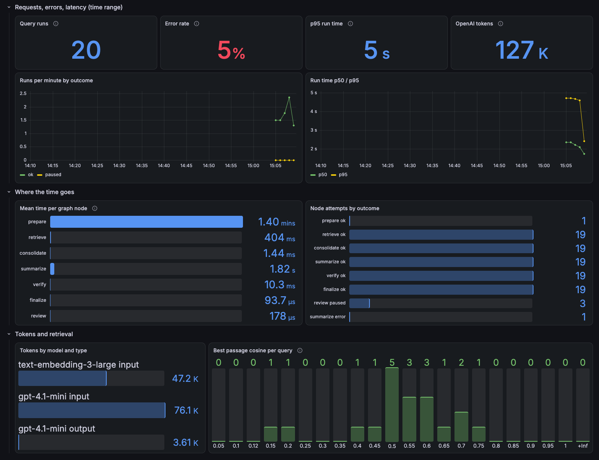
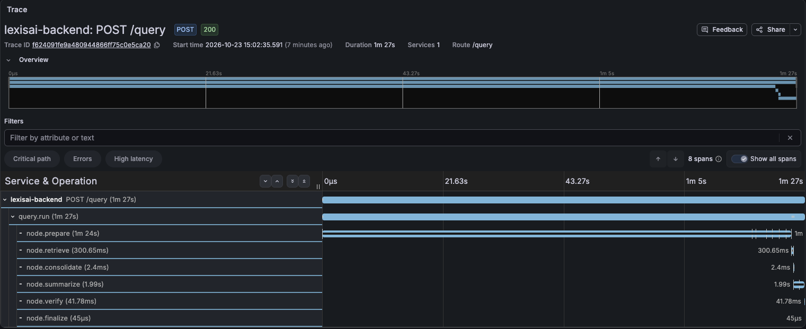
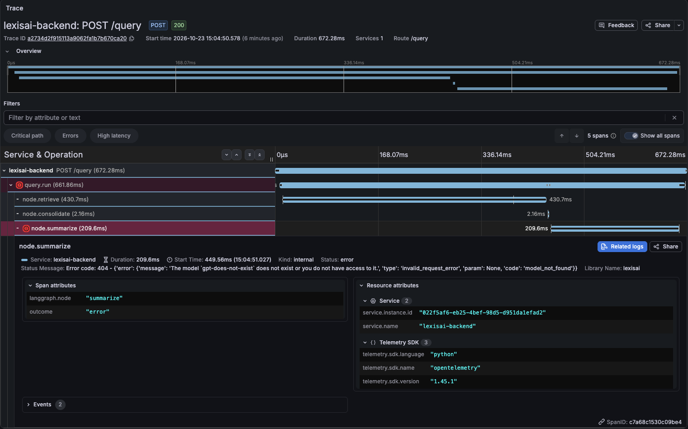
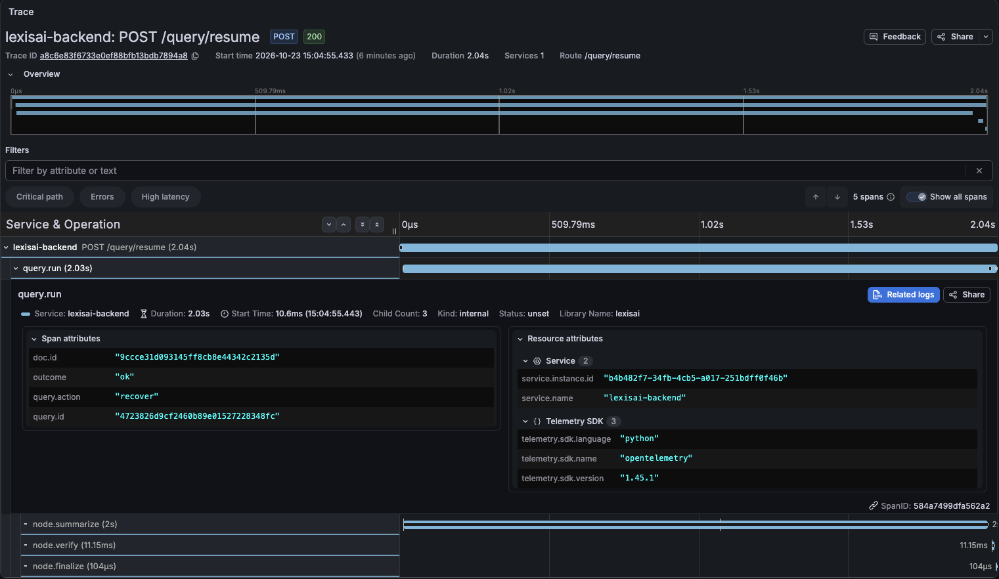

# LexisAI Architect

Upload a document (PDF, DOCX, PPTX, HTML or an image), ask questions about it, and get a streamed answer
with page citations and clickable source passages. The backend (FastAPI) extracts the document with
Docling, retrieves passages with hybrid parent–child search (vectors + BM25, fused with RRF), and runs each
question through a LangGraph pipeline: retrieve → consolidate → summarize → verify, with an evidence gate,
human review of flagged answers, retries, and recovery from a checkpoint. The frontend is Next.js.

- Setup and running: [how_to_run.md](how_to_run.md)
- Design: [spec.md](spec.md); architecture notes: [CLAUDE.md](CLAUDE.md)
- Retrieval and answer-quality evaluation: [RAG_IMPROVEMENT_REPORT.md](RAG_IMPROVEMENT_REPORT.md)

## Observability

The backend is instrumented with OpenTelemetry: one trace per request, one span per query graph node, and
request, error, latency, token and retrieval-score metrics. `docker compose --profile obs up` starts
Grafana with Tempo and Prometheus at http://localhost:3002 (setup in
[how_to_run.md](how_to_run.md#可观测性opentelemetry--grafana可选)).

**Dashboard.** Runs and errors, run time, where the time goes per graph node, OpenAI tokens per model,
and how close the best passage was to each question (below 0.12 the evidence gate answers without
calling the LLM).

**A document's first query.** The `prepare` node (Docling extraction, chunking, embedding) takes 84 of the
87 seconds; its stage events show extraction alone took 77.

**A failed run.** The answer step failed (here, a model name that doesn't exist), so `node.summarize` and
the run are marked as errors, with the error message on the span. The HTTP status is still 200, because
the error is sent as an event in the stream.

**The same run, recovered.** `POST /query/resume` with `recover` continues from the failed node: only
`summarize`, `verify` and `finalize` run again. `query.id` links it to the failed run's trace.

